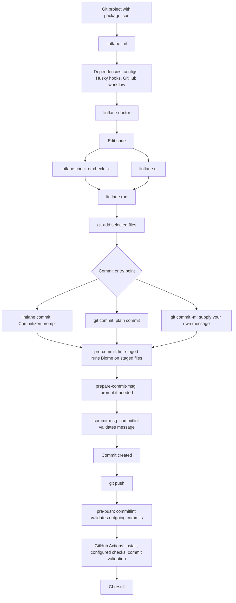

# How Lintlane works

Lintlane connects code checks, Git hooks, commit messages, and CI for JavaScript,
React, and Next.js projects. This guide groups its commands by the step where
you use them. See [README.md](README.md) for the main reference.

## Workflow at a glance



This diagram shows a successful path. A failing check blocks the relevant
operation until you resolve it. The full `lintlane run` pipeline is a manual
local check; the commit hook runs staged-file checks, and the push hook checks
commit messages. Husky hooks run only when installed and enabled.

## Each utility and its responsibility

| Utility | What it does | Configuration / entry point |
| --- | --- | --- |
| **Lintlane** | Sets up the project, resolves checks, runs tools, diagnoses problems, serves the dashboard, and generates CI. | `lintlane` settings in `package.json`; CLI commands below. |
| **Biome** | Formats code and checks lint rules; applies supported fixes when asked. | `biome.json`, extending a Lintlane preset. |
| **lint-staged** | Runs configured commands on staged files and manages partially staged files so unstaged edits stay separate. | `lint-staged` in `package.json`, or an existing lint-staged config. |
| **Husky** | Connects Git events to the project's hook scripts. | `.husky/*`, the `prepare` script, and Git's `core.hooksPath`. |
| **Commitizen** | Asks questions and builds a Conventional Commit message. | `config.commitizen.path` in `package.json`. |
| **cz-conventional-changelog** | Supplies Commitizen's standard questions for type, scope, description, and other commit fields. | Loaded by `lintlane/presets/commitizen.cjs`. |
| **commitlint** | Validates a supplied message or messages from Git history. | `commitlint.config.mjs`, normally exporting `lintlane/commitlint`. |
| **@commitlint/config-conventional** | Supplies the baseline Conventional Commits validation rules. | Extended by Lintlane's commitlint preset. |
| **Git** | Tracks staged changes, creates commits, invokes hooks, and pushes history. | The project's Git repository. |
| **npm / pnpm / Yarn / Bun** | Installs dependencies and runs the project's scripts. | `packageManager` in `package.json`, then lockfile, launcher, or npm fallback. |
| **GitHub Actions** | Runs the generated remote workflow. | `.github/workflows/biome.yml`. |
| **Your type checker, build tool, and test runner** | Run through detected or configured project scripts. Lintlane does not install these tools for you. | `scripts` and `lintlane.checks` in `package.json`. |

Lintlane bundles lint-staged, Commitizen, its standard adapter, and commitlint
dependencies. Biome is a peer dependency installed into the consuming project;
Husky is installed there when hook setup is enabled.

## Step 1 — Install and configure

Run inside a Git repository with `package.json`. Node.js 22 or newer is required.
Examples use `npx`; use `pnpm dlx`, `yarn dlx`, or `bunx` for initial setup if
preferred. After installation, you can use `pnpm exec lintlane`,
`yarn lintlane`, or `bunx lintlane` for the same commands.

```sh
npx lintlane init --dry-run
npx lintlane init
npx lintlane doctor
```

`init` installs missing dependencies and adds missing configuration. Existing
configuration is preserved. Unmodified older Lintlane hooks can be upgraded;
edited hooks are reported and left alone. Running `lintlane` without a command
also defaults to `init`.

| Setup option | Purpose |
| --- | --- |
| `init --dry-run` | Preview actions without changing files or installing packages. |
| `init --preset base` | Use recommended rules with the React domain. |
| `init --preset strict` | Use stricter rules; this preset is selected explicitly. |
| `init --preset next` | Use the base rules plus the Next.js domain. |
| `init --no-hooks` | Skip Husky and hook setup. |
| `init --no-commit-lint` | Skip the commit-message hooks: `commit-msg`, `prepare-commit-msg`, and `pre-push`. |
| `init --no-ci` | Skip generating the GitHub Actions workflow. |
| `init --skip-install` | Print dependency installation commands instead of executing them. |

Options can be combined. Without `--preset`, Next.js selects `next`; other
projects use `base`.

Default setup adds these pieces when missing:

| File / setting | Purpose |
| --- | --- |
| `biome.json` | Select the Biome preset. |
| `scripts.check`, `scripts.check:fix` | Expose local code checks. |
| `scripts.prepare` | Set up Husky when dependencies are installed. |
| `lint-staged` | Run Biome fixes on staged files. |
| `config.commitizen` | Select the guided commit adapter. |
| `commitlint.config.mjs` | Select commit message rules. |
| `.husky/pre-commit` | Check staged code. |
| `.husky/prepare-commit-msg` | Prompt for a message on eligible plain commits. |
| `.husky/commit-msg` | Validate the commit message. |
| `.husky/pre-push` | Validate outgoing commit messages. |
| `.github/workflows/biome.yml` | Run the generated CI workflow. |

## Step 2 — Check and fix code while developing

| Command | Result |
| --- | --- |
| `npx lintlane check` | Run `biome check .` without writing fixes. |
| `npx lintlane check src` | Check a particular path; multiple paths are supported. |
| `npx lintlane check:fix` | Run `biome check --write .` to apply supported fixes. |
| `npx lintlane check:fix src` | Apply supported fixes within selected paths. |
| `npx lintlane ci` | Run `biome ci --reporter=github .` without writing fixes. |
| `npx lintlane ci src` | Run the Biome CI command on selected paths. |

`ci` is the Biome-only command. Use `run` for the broader project pipeline.

## Step 3 — Run the project's checks

| Command | Result |
| --- | --- |
| `npx lintlane run --list` | List available checks and whether each runs by default. |
| `npx lintlane run` | Run enabled, detected checks in order; stop after the first failure. |
| `npx lintlane run --keep-going` | Continue through the remaining checks after a failure. |
| `npx lintlane run biome test` | Run selected available checks in pipeline order. |
| `npx lintlane run install` | Explicitly run the frozen-lockfile dependency install. |

The pipeline order is:

| Order | Check ID | What runs |
| --- | --- | --- |
| 1 | `install` | Frozen-lockfile install for the detected package manager; off by default locally. |
| 2 | `biome` | `biome ci .`. |
| 3 | `typecheck` | First detected script: `typecheck`, `type-check`, `check-types`, or `tsc`. Locally, a `tsconfig.json` and installed `tsc` can provide a `tsc --noEmit` fallback. |
| 4 | `build` | The project's `build` script, when available. |
| 5 | `test` | The project's `test` script, excluding npm's placeholder. |

Customize the pipeline in `package.json`:

```json
{
  "lintlane": {
    "checks": {
      "biome": true,
      "typecheck": true,
      "build": false,
      "test": "test:unit"
    }
  }
}
```

`false` disables a check; `true` keeps detection; a string selects an existing
script for `typecheck`, `build`, or `test`. Biome accepts only a boolean.
`install` is selected explicitly on the CLI, rather than configured here.
Missing checks are not invented: add the relevant project scripts to enable them.

## Step 4 — Review results in the dashboard

| Command | Result |
| --- | --- |
| `npx lintlane ui` | Start the local dashboard and open the browser; default port is `4321`. |
| `npx lintlane ui --port 5000` | Use a different port. |
| `npx lintlane ui --no-open` | Start the server without opening the browser. |

The **Lint** tab shows Biome diagnostics, proposed fix diffs, and actions to
apply fixes. The **CI** tab runs the shared project checks with live output,
statuses, timings, and a Stop action. Open the exact URL printed by the command;
it contains the dashboard's per-run access token.

## Step 5 — Stage changes and create a commit

```sh
git add src/example.ts
npx lintlane commit
```

| Command | Result |
| --- | --- |
| `npx lintlane commit` | Start Commitizen's guided prompt and create a commit. |
| `npx lintlane c` | Alias for `commit`. |
| `npx lintlane commit --dry-run` | Use Commitizen's dry-run mode without creating a commit. |
| `npx lintlane commit --retry` | Reuse the last message after a failed commit. |
| `npx lintlane commit -a` | Stage tracked changes before committing. |
| `npx lintlane commit --signoff` | Add a sign-off through Commitizen. |
| `npx lintlane commit -- -n` | Pass Git's hook bypass option for this commit. |
| `npx lintlane commit -- -S` | Pass `-S` to Git to sign the commit. |
| `git commit` | Use the hook-based guided prompt when eligible. |
| `git commit -m "feat: add search"` | Supply a message directly; commitlint still validates it. |

Arguments after `--` go to Git. Commitizen's `--signoff` and Git's signing
option `-- -S` have different purposes.

The hook sequence during a normal commit is:

1. **`pre-commit` → lint-staged → Biome:** check and fix staged files using the
   configured lint-staged tasks. Its default task is
   `biome check --write --no-errors-on-unmatched --files-ignore-unknown=true`.
   lint-staged manages partially staged files and restores state when tasks fail.
2. **`prepare-commit-msg` → Commitizen, when needed:** prompt on a plain
   `git commit`. Skip the prompt for a supplied message, merge, amend, CI,
   Windows, missing terminal, or `LINTLANE_NO_PROMPT=1`. With
   `lintlane commit`, the guided message has already been collected.
3. **`commit-msg` → commitlint:** validate the completed message; reject the
   commit if it violates the configured rules.

Commitizen helps compose the message; commitlint enforces the rules. Optional
`lintlane.commit` settings such as `types`, `messageLengthLimit`, and
`allowedPrefixes` affect Lintlane's commitlint preset. Customize the Commitizen
adapter separately to change the prompt.

## Step 6 — Validate messages and push

| Command | Result |
| --- | --- |
| `npx lintlane check-commit --message "feat: add search"` | Validate one message string. |
| `npx lintlane check-commit --commit-msg-file .git/COMMIT_EDITMSG` | Validate a message file. |
| `npx lintlane check-commit --rev-range origin/main..HEAD` | Validate every commit in a range. |
| `npx lintlane check-commit -d` | Validate commits since the detected default branch. |
| `npx lintlane check-commit --use-default-range` | Long form of `-d`. |
| `printf 'feat: add search\n' \| npx lintlane check-commit` | Validate a message from standard input. |
| `git push` | Trigger `pre-push`, then push if outgoing commit messages pass. |

The pre-push hook provides another message check for commits that bypassed the
commit-time hook. It does not run the full build/test pipeline. Run
`npx lintlane run` before pushing when you want those results locally.

## Step 7 — Let CI verify the change

The generated GitHub Actions workflow runs on pull requests and pushes to `main`.
It installs dependencies with the detected package manager, validates commit
messages on pull requests when commit checking was enabled during setup, and
runs the configured CI checks.
The CLI, dashboard, and workflow generator share check detection logic.

The workflow file is generated during setup and is not continuously rewritten.
After changing `lintlane.checks` or adding project scripts, review the workflow
and run `doctor` to identify missing CI steps. The local `tsc --noEmit` fallback
is not emitted as a CI step; define a typecheck script to include it in CI.

## Diagnose problems and get help

| Command | Result |
| --- | --- |
| `npx lintlane doctor` | Read-only report covering tools, hooks, configuration, and CI, with suggested fixes. |
| `npx lintlane doctor --json` | Machine-readable report. |
| `npx lintlane --help` | Main commands and setup/dashboard options. |
| `npx lintlane commit --help` | Guided commit options. |
| `npx lintlane check-commit --help` | Message validation options. |

`doctor` exits with code `1` for broken setup; warnings alone do not fail it.
Resolve reported issues, then run it again.

### Internal hook commands

Husky invokes these automatically through the generated `.husky` scripts.
They are implementation entry points rather than normal daily commands.

| Entry point | Utility invoked |
| --- | --- |
| `lintlane hook pre-commit` | lint-staged. |
| `lintlane hook prepare-commit-msg <message-file> [source]` | Commitizen when eligible. |
| `lintlane hook commit-msg <message-file>` | commitlint on the message file. |
| `lintlane hook pre-push <remote> [url]` | commitlint on outgoing history, using Git's ref updates from standard input. |

## Typical daily sequence

```sh
# Edit code, inspect issues, and apply supported fixes.
npx lintlane check
npx lintlane check:fix

# Run enabled project checks before committing or pushing.
npx lintlane run

# Choose what to commit, then answer the guided questions.
git add src/example.ts
npx lintlane commit

# The pre-push hook validates outgoing messages; GitHub Actions follows.
git push
```
